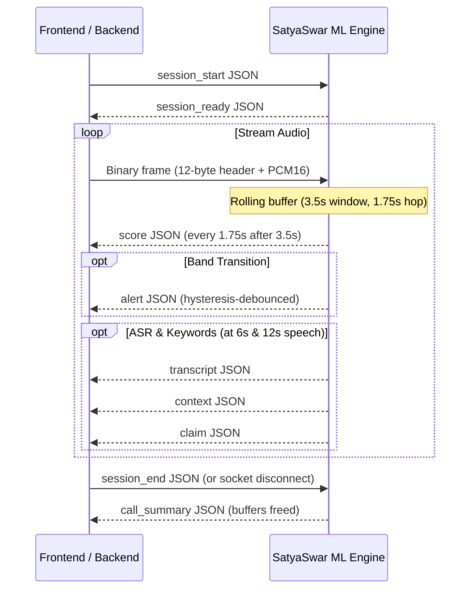

# SatyaSwar ML Integration Contract (v1.0)

> **Source of Truth:** `Implementation.md`, Section 6  
> **Target Audience:** Member 1 (App / Dashboard) & Member 2 (Backend / Verification)

---

## 1. Agreed Team Decisions (D1 to D9)

| ID | Decision | Agreed Implementation |
|---|---|---|
| **D1** | **Audio Sent by Client** | Non-overlapping **1.75 s chunks** (28,000 samples). Engine accumulates and builds 3.5 s rolling windows. (Full 3.5 s window mode also supported). |
| **D2** | **ML Deployment** | **In-process library** via `satyaswar_ml` (Mode A) is primary. Standalone WebSocket/REST service via `ws_app.py` (Mode B) on port 8100 is supported. |
| **D3** | **Score Direction** | `spoof_score` in `[0, 1]`, **higher means more likely synthetic / cloned**. |
| **D4** | **Risk Bands** | `low`, `medium`, `high`, plus `insufficient` (outcome: `insufficient_evidence`). |
| **D5** | **Alerting** | Engine emits `alert` events on committed band transitions with hysteresis; **App plays the alert audio**. |
| **D6** | **Contact List** | **Backend passes contacts** in `session_start`. Engine stores nothing persistently. |
| **D7** | **Decision Function** | Backend owns production decision function; ML provides reference implementation in `satyaswar_ml.decision.decide`. |
| **D8** | **Alert Languages** | English (`en`) and Hindi (`hi`). UI / voice prompt follows app language preference. |
| **D9** | **Schema Version** | `schema_version: "1.0"` in every JSON control and event message. |

---

## 2. Audio Framing & Transport

- **Sample Format:** PCM16 Little-Endian, 16 kHz, Mono.
- **Binary Header Layout (12 bytes, Little-Endian):**
  - `uint32 seq` (4 bytes, little-endian, starts at 0, increments by 1 per frame)
  - `uint64 client_ts_ms` (8 bytes, little-endian epoch timestamp in milliseconds)
  - Followed by raw PCM16 audio bytes.
- **Payload Dimensions:**
  - **Chunk Mode (Recommended):** 28,000 samples = 56,000 bytes payload. Total frame size = 56,012 bytes.
  - **Window Mode:** 56,000 samples = 112,000 bytes payload. Total frame size = 112,012 bytes.

---

## 3. Session Lifecycle

1. **Start:** Client sends `session_start` message. Engine initialises ring buffers and replies `session_ready`.
2. **Stream:** Client sends binary frames. Engine emits `score` events every 1.75 s after the first 3.5 s window.
3. **End:** Client sends `session_end`. Engine emits `call_summary` and frees all buffers.
4. **Reconnect:** Client reconnects with `session_start`, matching `call_id`, and `resume: true`. Engine retains session state for up to 60 seconds.

---

## 4. Message Schemas

Detailed schemas are generated in `docs/events.schema.json`.

### 4.1 Upstream Messages (Client -> Engine)
- `session_start`: `{ "schema_version": "1.0", "type": "session_start", "call_id": "...", "mode": "chunks", "contacts": [...] }`
- `config_update`: `{ "schema_version": "1.0", "type": "config_update", "telephony_profile": "g711_ulaw" }`
- `session_end`: `{ "schema_version": "1.0", "type": "session_end" }`

### 4.2 Downstream Events (Engine -> Client / Dashboard)
- `session_ready`: Engine initialized, warm-up latency reported.
- `score`: Voice authenticity score (`spoof_score`, `smoothed_score`, `band`, `outcome`, `evidence`, `language`, `why`, `mock`).
- `transcript`: Transcribed speech segment (sent transiently, dropped immediately).
- `context`: Detected scam risk categories (`urgency`, `secrecy`, `money`, `otp_credentials`, `authority`, `family_emergency`).
- `claim`: Suggested contact candidates based on caller's contact list (never auto-selected).
- `alert`: Spoken and UI alert event on band transition.
- `info`: System operational advisory (e.g. `windows_dropped`, `asr_unavailable`).
- `error`: Recoverable or fatal error code.
- `call_summary`: Final aggregated call metrics for backend persistence. Strictly no raw audio or transcripts.

---

## 5. Security & Privacy Rules

1. **Transient In-Memory Analysis:** All audio is processed in RAM ring buffers and deleted immediately upon session end.
2. **No Persistent Transcripts:** Transcripts exist only as transient events dispatched over WebSocket.
3. **Mock Transparency:** Any synthetic test event generated in mock mode carries `"mock": true`.
